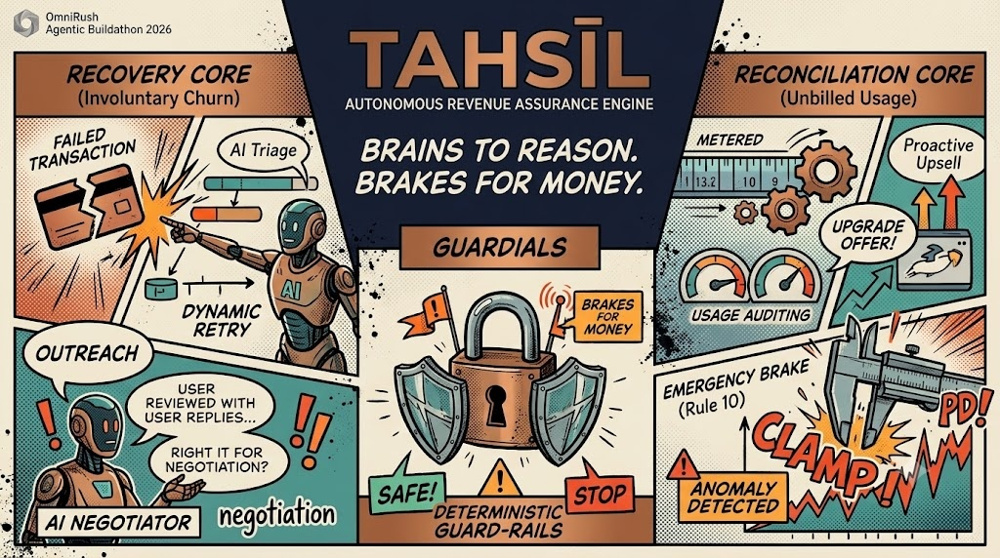
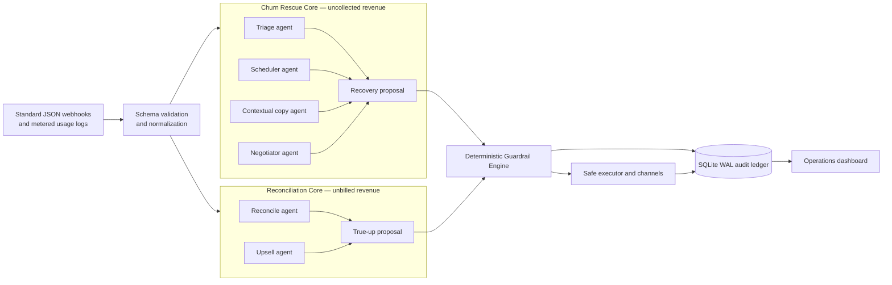

<p align="center">
  
</p>

<p align="center"><strong>OmniRush Agentic Buildathon 2026 · Dual-Core Autonomous Revenue Assurance Engine</strong></p>

# TAHSĪL

## Dual-Core Autonomous Revenue Assurance Engine

> **Brains to reason. Brakes for money.**

TAHSĪL is an autonomous, vendor-agnostic revenue assurance engine for recurring-revenue businesses. It combines concurrent agentic reasoning with deterministic financial controls so teams can recover more revenue without allowing an intelligent proposal to become an uncontrolled financial action.

Built for the **OmniRush Agentic Buildathon 2026**, TAHSĪL treats revenue assurance as two connected problems:

1. **Uncollected revenue** — a valid subscription payment failed and needs a safe recovery path.
2. **Unbilled revenue** — metered usage was delivered but never reconciled into an invoice.

The result is a single FastAPI service with SQLite/WAL persistence, Pydantic V2 contracts, a local vector history index, mocked universal execution, and a reproducible Docker workflow.

---

## Executive Summary

TAHSĪL is designed for SaaS, API platforms, marketplaces, and subscription businesses that need autonomous action around money without surrendering policy control.

| Business problem | Autonomous response | Safety boundary |
|---|---|---|
| Failed recurring debit | Predict, schedule, negotiate, notify, or escalate | Retry budgets, cooldowns, mandate checks, fraud triage, incentive caps, idempotency |
| Usage delivered but not billed | Aggregate usage, calculate overage, propose an upgrade, generate a true-up verdict | 150% surge ceiling, current-cycle idempotency, runaway-usage emergency freeze |
| Customer communication | Personalized, context-aware notices across email, SMS, and WhatsApp | Mocked dispatch plus durable audit events |

TAHSĪL never lets the reasoning layer execute directly. Agents produce structured proposals; a separate symbolic firewall decides what may actually happen.

---

## Why This Matters

Revenue leakage appears in two directions:

- **Churn leakage:** a customer wants to remain active, but a failed payment becomes involuntary churn.
- **Metering leakage:** the platform fulfilled usage, but the billing system did not capture the corresponding value.

Most recovery systems handle only the first. TAHSĪL closes both loops with a common design principle:

> **Autonomy can recommend. Deterministic policy must authorize.**

The engine is provider-neutral at its application boundary. Payment and billing systems send standard JSON. TAHSĪL normalizes the payload, reasons over the business state, applies hard rules, and emits a structured result or a human escalation.

---

## Dual-Core Architecture



### Core 1: Churn Rescue

The Churn Rescue Core handles failed recurring payments across cards, bank debit rails, and other payment instruments through a standard normalized state model.

It can:

- infer whether a failure is transient, exhausted, revoked, or anomalous;
- align retry timing with customer liquidity windows;
- avoid known bank maintenance windows;
- switch from automated retry to a secure payment-link recovery path;
- pause a mandate when continued attempts would create friction;
- negotiate customer-requested extensions and concessions;
- route high-risk cases to human operations;
- send respectful, context-aware notices through multiple channels.

### Core 2: Usage Reconciliation

The Reconciliation Core captures revenue that was delivered but not invoiced.

It accepts:

- `UsageRecord` entries with customer, resource, units, and timestamp;
- a `ContractTier` with base fee, included units, grace units, and overage rate.

It then:

1. aggregates the customer’s usage;
2. calculates the surplus above included plus grace units;
3. computes the raw overage charge in paise;
4. runs the proactive Upsell agent concurrently with charge computation;
5. detects runaway usage velocity;
6. sends the proposal through Rules 8, 9, and 10;
7. writes `TRUE_UP_AUDITED` and, when approved, `TRUE_UP_INVOICE_GENERATED` ledger events.

The customer receives a structured `TrueUpVerdict`, not an unchecked invoice instruction.

---

## The 10-Rule Deterministic Guardrail Engine

The guardrail layer is the financial safety system. It is intentionally deterministic, inspectable, and independent from the model that proposed the action.

### Churn Rescue rules

| Rule | Control | Outcome |
|---:|---|---|
| 1 | Mandate validity | Inactive or revoked mandates become `DO_NOTHING`. |
| 2 | Retry budget cap | Exhausted retry budgets become `ESCALATE_TO_HUMAN`. |
| 3 | Mandatory cooldown | Retry attempts are clamped to at least 24 hours apart. |
| 4 | Bank downtime collision | Retries inside a maintenance window shift past the window with a safety buffer. |
| 5 | Incentive ceiling | Discounts are clamped to the merchant-configured maximum. |
| 6 | Atomic action idempotency | Duplicate payment actions are blocked by SQLite locks. |
| 7 | Policy pass-through | A compliant proposal is emitted unchanged. |

### Reconciliation rules

| Rule | Control | Outcome |
|---:|---|---|
| 8 | True-up surge ceiling | A proposed overage charge cannot exceed **150% of the customer’s base fee**. The charge is clamped and marked `was_clamped=true`. |
| 9 | Current-cycle audit idempotency | A customer cannot receive more than one true-up invoice in the current billing cycle. Duplicate work returns a zero charge. |
| 10 | **Runaway Script Emergency Freeze** | If one usage batch exceeds **500% of the monthly allowance**, the engine freezes the charge at zero and returns `EMERGENCY_FREEZE_ESCALATE_TO_HUMAN`. |

Rule 10 exists to prevent astronomical bill shock caused by an infinite loop, runaway job, compromised credential, or telemetry defect. The system preserves the audit context while refusing to monetize the anomaly automatically.

### The safety invariant

```text
Agent proposal → deterministic evaluation → approved action, clamp, no-op, or human escalation
```

There is no direct model-to-money path.

---

## Multi-Agent Swarm

TAHSĪL uses a structured multi-agent pattern designed for concurrent reasoning and observable decisions. The buildathon operating profile is powered by **GPT-6 Astra** through a structured model-client seam, with a deterministic heuristic fallback for offline execution.

This architecture directly fulfills the **Best Use of OmniRush** category criteria: autonomous agents are coordinated in a real product flow, their outputs are merged into typed proposals, and every financial action is checked by a non-LLM policy layer.

### Agent roles

| Agent | Responsibility | Core |
|---|---|---|
| **Triage** | Scores failure risk, detects fraud signals, selects a candidate intervention, and escalates high-risk cases. | Churn Rescue |
| **Scheduler** | Finds a viable retry time using liquidity telemetry, cooldown rules, and timing context. | Churn Rescue |
| **Negotiator** | Interprets a customer reply, extracts requested dates or concessions, and submits them to guardrails. | Churn Rescue |
| **Upsell** | Detects meaningful usage surplus and drafts a personalized higher-tier offer that can waive the current overage fee. | Reconciliation |
| **Reconcile** | Aggregates usage, calculates unbilled units and raw overage, and creates the typed true-up proposal. | Reconciliation |

The swarm coordinates Triage, Scheduler, Negotiator, Upsell, and Reconcile capabilities in one autonomous flow. Independent work runs concurrently: Triage, Scheduler, and contextual Copy merge into one recovery proposal, while Reconcile runs charge calculation alongside Upsell evaluation. Negotiator joins on customer-reply events and re-enters the same guardrail firewall without bypassing policy.

### Model boundary

- Structured inputs and outputs are validated with Pydantic V2.
- The model client can be injected for Astra-compatible orchestration.
- When no API credential is configured, deterministic heuristics keep the demo and tests fully offline.
- The model proposes; the guardrail engine authorizes.

---

## Standard JSON Integration

TAHSĪL does not require a provider-specific SDK at the application boundary. Any payment provider, billing system, or internal service can send a JSON webhook containing the identifiers and business fields required by the normalizer.

### Payment failure ingestion

```http
POST /api/webhook/ingest
Content-Type: application/json
```

```json
{
  "invoice_id": "inv_1001",
  "customer_id": "cust_42",
  "payment_id": "pay_1001",
  "transaction_id": "txn_1001",
  "plan_value_paise": 199900,
  "currency": "INR",
  "retry_count": 1,
  "last_failure_reason": "INSUFFICIENT_FUNDS",
  "mandate_status": "active"
}
```

The normalizer also accepts common webhook shapes, but the portable contract is the generic JSON form above.

### Usage leakage audit

```http
POST /api/audit/usage-leakage
Content-Type: application/json
```

```json
{
  "customer_id": "cust_42",
  "raw_usage_logs": [
    {
      "customer_id": "cust_42",
      "resource_name": "api_calls",
      "units_consumed": 185000,
      "recorded_at": "2026-10-19T12:00:00"
    }
  ],
  "contract": {
    "tier_name": "growth",
    "base_fee_paise": 100000,
    "included_units": 100000,
    "overage_rate_paise": 2,
    "grace_units": 10000
  }
}
```

Example response shape:

```json
{
  "customer_id": "cust_42",
  "approved_charge_paise": 150000,
  "unbilled_units": 75000,
  "was_clamped": true,
  "clamp_reason": "true-up charge exceeded 150% of the contract base fee",
  "upsell_proposed": true,
  "upsell_copy": "Hi cust_42, your usage exceeded the growth allowance..."
}
```

---

## API Surface

| Method | Endpoint | Purpose |
|---|---|---|
| `GET` | `/health` | Service health and version. |
| `POST` | `/api/webhook/ingest` | Universal standard-JSON payment failure ingestion. |
| `POST` | `/api/webhook/payment-failed` | Alias for payment failure ingestion. |
| `POST` | `/api/webhook/reply` | Two-way customer negotiation. |
| `POST` | `/api/audit/usage-leakage` | Metered usage audit and guarded true-up. |
| `GET` | `/api/events` | Durable event-sourced audit trail. |
| `GET` | `/api/states` | Current recovery states. |
| `GET` | `/api/metrics` | Recovery telemetry and override metrics. |
| `GET` | `/api/scenarios` | Demo recovery scenarios. |
| `POST` | `/api/simulate/{scenario_name}` | Run one recovery scenario. |
| `POST` | `/api/simulate-all` | Run the recovery scenario set. |
| `POST` | `/api/reset` | Clear local demo state and locks. |

Interactive OpenAPI documentation is available at `/docs` when the service is running.

---

## Auditability and Operations

SQLite is configured with WAL mode for durable local persistence. The state store records:

- normalized recovery states;
- agent completion events;
- proposals and guardrail verdicts;
- mocked execution payloads;
- channel dispatch results;
- true-up audit and invoice events;
- atomic payment and billing-cycle idempotency locks.

The dashboard at `/dashboard` exposes a high-density operations view with KPI telemetry, intervention history, guardrail overrides, and proposal-versus-verdict inspection. The landing page at `/` provides the product-level entry point.

External payment calls are intentionally mocked in this submission. The executor emits provider-neutral REST-shaped payloads and records them in the audit ledger, making the integration boundary visible without moving real money.

---

## Reproducibility and Deployment

### Judging setup

The intended judging path is one command:

```bash
make run-demo
```

This builds the pinned Docker image and runs the narrated demo in an ephemeral container. It exercises failed-payment recovery, liquidity timing, retry exhaustion, downtime shifting, mandate revocation, incentive clamping, contextual outreach, negotiation, usage true-up, proactive upsell, and the runaway-script emergency freeze.

### Local development

Prerequisites:

- Python `3.11.11`, pinned in `.python-version`;
- Docker Engine with Compose for the full reproducible path;
- GNU Make for the convenience targets.

```bash
python -m venv .venv
# Activate .venv using the command for your shell.
python -m pip install --requirement requirements.lock

# Run the offline test suite
python -m pytest tests/ -v

# Start the API locally
uvicorn app.main:app --reload

# Run the narrated demo without Docker
python scripts/demo_script.py
```

The optional `.env` file may contain a model credential based on `.env.example`. The credential is never committed and is not required for the offline heuristic path.

### Docker services

```bash
# API at http://localhost:8000
docker compose up --build app

# Ephemeral narrated demo
docker compose run --rm demo

# Tests in the same reproducible image
docker compose run --rm demo python -m pytest tests/ -v
```

The `Dockerfile` installs the pinned lockfile, the FAISS/NumPy runtime, and the required system library from a clean `python:3.11.11-slim-bookworm` base image. No global project dependency installation is required.

### Live deployment readiness

`render.yaml` provides a Docker-based web-service blueprint for Render-compatible deployment:

```bash
# In a connected deployment environment, use the repository's render.yaml blueprint.
# The service listens on PORT 8000 inside the container.
```

The container starts FastAPI with Uvicorn on `0.0.0.0:8000`. Set the optional model credential as a deployment secret; keep credentials out of source control. For production use, attach durable storage or an external database for the audit ledger before enabling real financial execution.

---

## Repository Map

```text
TAHSIL/
├── app/
│   ├── static/banner.jpg    # OmniRush Agentic Buildathon 2026 header visual
│   ├── main.py              # FastAPI API and pipeline entry points
│   ├── schemas.py           # Pydantic V2 contracts and webhook normalization
│   ├── llm_orchestrator.py  # Concurrent Churn Rescue agent swarm
│   ├── reconcile_agt.py     # Reconcile and Upsell agents
│   ├── guardrail_engine.py  # Ten deterministic financial safety rules
│   ├── state_store.py       # SQLite WAL state, events, and idempotency
│   ├── executor.py          # Provider-neutral mocked action executor
│   ├── channels/             # Concurrent multi-channel notices
│   ├── simulator.py          # Payment recovery scenario fixtures
│   └── vector_index.py       # Local customer-history retrieval
├── scripts/demo_script.py    # Narrated end-to-end buildathon demo
├── tests/                    # Recovery, agent, API, and true-up tests
├── static/                   # Landing page and operations dashboard
├── Dockerfile                # Pinned reproducible runtime image
├── docker-compose.yml        # API and ephemeral demo services
├── render.yaml               # Live deployment blueprint
├── requirements.txt          # Direct dependency declarations
├── requirements.lock         # Reproducible dependency lockfile
├── Makefile                  # `test` and `run-demo` commands
└── .env.example              # Redacted optional configuration template
```

---

## Verification

The regression suite covers:

- all deterministic recovery rules;
- concurrent agent execution and proposal merge;
- fraud and anomaly escalation;
- contextual customer history retrieval;
- customer reply negotiation;
- multi-channel dispatch;
- standard usage reconciliation;
- proactive upsell thresholds;
- Rule 8 surge clamping;
- Rule 9 true-up idempotency;
- Rule 10 runaway usage freeze.

Run:

```bash
python -m pytest tests/ -v
```

---

## Closing Principle

TAHSĪL is not an unchecked autonomous billing bot. It is a revenue assurance control plane: concurrent agents find the opportunity, typed schemas make the intent explicit, and deterministic guardrails decide whether money may move.

**Brains to reason. Brakes for money.**
