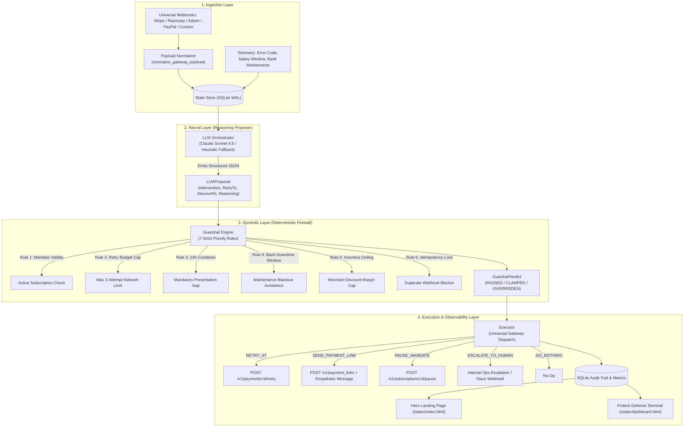

# TAHSĪL (تحصيل) — Autonomous AI Revenue Recovery Engine
### Universal, Platform-Agnostic Agentic Middleware with Deterministic Financial Guardrails

<div align="center">

[](#-architecture-the-neuro-symbolic-split)
[](#-universal-gateway-support)
[](https://python.org)
[](https://fastapi.tiangolo.com)
[](https://anthropic.com)
[](LICENSE)

<br/>


<br/>

**“Brains to Reason. Brakes for Money.”**  
*An institutional-grade, neuro-symbolic recurring revenue recovery engine engineered for global SaaS, B2B subscriptions, and fintech payment rails (Cards, UPI AutoPay, eNACH, ACH, SEPA, and Direct Debit).*

[🚀 Quickstart](#-quickstart-guide) • [🏛 Architecture](#-architecture-the-neuro-symbolic-split) • [🛡 Guardrail Rules](#-the-7-deterministic-guardrail-rules) • [⚡ Staged Failure Showcase](#-the-staged-failure-showcase-spotlight) • [🖥 Defense Terminal](#-fintech-defense-terminal--ui-showcase) • [📡 REST API](#-rest-api-reference)

</div>

---

## 📌 Executive Summary

Recurring payment failures and involuntary subscription churn cost subscription businesses and merchants billions annually. Yet naive automated retries cause severe customer friction, payment gateway penalties, network dispute flags, and regulatory violations under modern banking standards.

## 🐳 Reproducible Docker Build

The project pins Python 3.11.11 in `.python-version` and all direct runtime/test dependencies in `requirements.txt` and `requirements.lock`. Docker installs the FAISS CPU runtime and starts the FastAPI service from a clean `python:3.11.11-slim-bookworm` image; the local FAISS history index is initialized in-process by `app.vector_index`.

Prerequisite: Docker Engine with the Compose plugin.

```bash
# Build and run the interactive seven-scenario demo in one command
make run-demo

# Start the FastAPI server on http://localhost:8000
docker compose up --build app

# Run the offline test suite in the reproducible image
docker compose run --rm demo python -m pytest tests/ -v
```

The demo and tests use the heuristic path when `ANTHROPIC_API_KEY` is absent. To enable the optional live model path, export `ANTHROPIC_API_KEY` before running Compose; secrets are passed through the environment and are not copied into the image. The `demo` Compose service is intentionally ephemeral so every judge run starts with a fresh SQLite database and local FAISS index.

**Tahsīl (تحصيل)** solves this with a **Neuro-Symbolic Hybrid Architecture**:
* **The Neural Layer (LLM Proposer)** uses Claude 3.5 Sonnet (with built-in heuristic fallback) to ingest rich transaction telemetry (gateway failure codes, customer LTV, salary liquidity windows, bank downtime forecasts) and reason through the optimal recovery strategy.
* **The Symbolic Layer (Deterministic Guardrail Engine)** acts as an unbreachable Python firewall. **The LLM never executes directly.** Every proposal must pass 7 strict priority rules enforcing retry attempt caps, 24-hour mandatory cooldowns, bank maintenance blackout shifts, and merchant discount caps.
* **The Execution Layer** safely logs and dispatches platform-agnostic REST payloads (`/v1/payments/{id}/retry`, `/v1/payment_links`, `/v1/subscriptions/{id}/pause`), formats empathetic customer recovery messages, and alerts merchant operations queues.

```
┌────────────────────────────────────────────────────────────────────────────────────────┐
│                                 THE NON-NEGOTIABLE AXIOM                               │
│                                                                                        │
│   The LLM NEVER executes any recovery action directly.                                 │
│   It only emits structured JSON candidate proposals.                                   │
│   A separate, pure-Python deterministic guardrail engine evaluates, clamps, or         │
│   overrides that proposal against compliance, network, and merchant rules before safe  │
│   execution.                                                                           │
└────────────────────────────────────────────────────────────────────────────────────────┘
```

---

## 🌐 Universal Gateway Support

Tahsīl is completely platform-agnostic. It features a built-in webhook payload normalizer that seamlessly ingests events from all major payment infrastructure providers:

| Provider | Webhook Event Signature | Normalized Entity Mapping |
|---|---|---|
| **Stripe** | `invoice.payment_failed`, `payment_intent.payment_failed` | Auto-extracts `invoice_id`, `payment_intent`, `customer`, `amount_due`, and decline codes. |
| **Razorpay** | `payment.failed`, `subscription.paused` | Auto-extracts `invoice_id`, `payment_id`, `customer_id`, `amount`, and error descriptions. |
| **Adyen** | `AUTHORISATION` (`success: false`) | Auto-extracts `merchantReference`, `pspReference`, `shopperReference`, and refusal reasons. |
| **PayPal** | `PAYMENT.SALE.DENIED`, `BILLING.SUBSCRIPTION.*` | Auto-extracts `invoice_number`, `billing_agreement_id`, `payer_id`, and decline summaries. |
| **Universal / Custom** | Standard JSON Payload | Ingests `payment_id`, `transaction_id`, `invoice_id`, `customer_id`, `plan_value_paise`. |

---

## ⚖️ Why Traditional Recovery Fails vs. Tahsīl

| Dimension | Naive Fixed Cron Retries | Unchecked LLM Agent | Tahsīl (Neuro-Symbolic Engine) |
|---|---|---|---|
| **Liquidity Timing** | ❌ Blind retries at fixed 24h intervals | ⚠️ Hallucinates arbitrary dates | ✅ **Alters retries to match customer salary liquidity windows** |
| **Bank Maintenance** | ❌ Hits nocturnal batch downtime (02:00–06:00) | ❌ Ignores CBS maintenance calendars | ✅ **Shifts debit past downtime window with 15m safety buffer** |
| **Regulatory Limits** | ❌ Breaches network 3-attempt caps | ❌ No compliance guarantees | ✅ **Strictly overrides to human ops when 3/3 attempts exhausted** |
| **Mandatory Cooldowns** | ❌ Triggers technical debit declines | ⚠️ May retry too quickly | ✅ **Clamps minimum 24-hour presentation spacing** |
| **Merchant Margins** | ❌ No dynamic payment links or incentives | ❌ May grant dangerous 20%+ discounts | ✅ **Clamps recovery discounts to merchant max cap (e.g., 5%)** |
| **Customer Experience** | ❌ Impersonal and aggressive dunning | ⚠️ Unpredictable tone variation | ✅ **Generates empathetic, personalized customer retention messaging** |
| **Idempotency** | ⚠️ Race condition vulnerable | ❌ No state locks | ✅ **Atomic SQLite locks prevent duplicate billing** |

---

## 🏛 Architecture: The Neuro-Symbolic Split



---

## 🛡 The 7 Deterministic Guardrail Rules

```
Rule 1: Subscription / Mandate Validity Check
   └─ IF mandate_status != "active" ➔ OVERRIDE to DO_NOTHING

Rule 2: Payment Network Retry Budget Cap (Max 3 Attempts)
   └─ IF proposal == RETRY_AT AND retry_count >= max_retry_budget ➔ OVERRIDE to ESCALATE_TO_HUMAN

Rule 3: Mandatory 24-Hour Cooldown
   └─ IF proposal.retry_ts < last_attempt_ts + 24h ➔ CLAMP retry_ts to (last_attempt_ts + 24h)

Rule 4: CBS Bank Downtime Window Avoidance
   └─ IF proposal.retry_ts collides with bank_downtime ➔ SHIFT retry_ts to (downtime_end + 15 min)

Rule 5: Merchant Incentive Ceiling
   └─ IF proposal.incentive_pct > max_incentive_pct ➔ CLAMP incentive_pct to max_incentive_pct (5%)

Rule 6: Atomic Idempotency Lock
   └─ IF is_locked(invoice_id, retry_count) == True ➔ OVERRIDE to DO_NOTHING

Rule 7: Policy Pass-Through
   └─ IF all compliance rules satisfied ➔ EMIT proposal as-is
```

---

## ⚡ The Staged Failure Showcase Spotlight

> **Scenario 3 (`scenario_exhausted_budget`) is our central demonstration feature.**  
> It highlights why autonomous agents handling real capital must have deterministic guardrails.

```
┌────────────────────────────────────────────────────────────────────────────────────────┐
│                             SCENARIO 3: THE STAGED FAILURE                             │
│                                                                                        │
│  1. INGESTION : High-value enterprise account ($49.99 / ₹4,999), failed 3/3 times.     │
│  2. NEURAL    : Claude 3.5 Sonnet observes high LTV and attempts a 4th debit retry:    │
│                 "Customer has high historical lifetime value; attempting another        │
│                  automated debit retry after cooldown."                                │
│  3. SYMBOLIC  : Guardrail Rule 2 catches the violation (3/3 attempts exhausted).       │
│  4. VERDICT   : OVERRIDDEN ➔ ESCALATE_TO_HUMAN                                         │
│                 Override Reason: "Network retry budget exhausted (attempted 3 of 3)"   │
│  5. EXECUTION : Dispatches an urgent Ops alert instead of an illegal bank debit!      │
└────────────────────────────────────────────────────────────────────────────────────────┘
```

---

## 🖥 Fintech Defense Terminal & UI Showcase

### 1. The Full-Viewport Dark Hero Page (`/static/index.html`)
* Cinematic background video loop with dual-stacked scrim gradients.
* Custom typography: `Sora` (200/300/400) for architectural branding + `JetBrains Mono` for command tags.
* Instant simulation console to trigger test webhooks or jump directly into the live ops terminal.

### 2. The High-Density Defense Terminal (`/static/dashboard.html`)
* **Universal KPI Strip**:
  - **Total Volume Analyzed**: Aggregate transaction capital ingested through the engine.
  - **Recovered Revenue**: Capital successfully routed through intelligent recovery retries and links.
  - **Recovery Rate (%)**: Recovery conversion efficiency percentage.
  - **Active Recovery Triggers**: Real-time count of active retries and payment links in-flight.
* **Active Recovery Triggers Bus**: Uniform, tactile hardware keys (`24H Cooldown`, `Salary Liquidity`, `Staged Failure Override`, `Bank Downtime Shift`, `Mandate Revocation`, `Incentive Capping`).
* **Live Split Audit Ledger**:
  - **Left**: Real-time **Intervention Log** with color-coded status badges (`[ PASSTHROUGH ]` vs `[ OVERRIDDEN ⚠️ ]`).
  - **Right**: Deep Deconstruction Drawer displaying the exact **Neural Proposal vs. Symbolic Guardrail Diff** with custom JSON syntax highlighting and empathetic messaging inspection.

---

## 🔍 Real vs. Mocked Boundaries (Transparency)

| Component | Status | Details |
|---|---|---|
| **LLM Reasoning Engine** | **REAL** | Structured tool calling using Anthropic Claude 3.5 Sonnet (`claude-sonnet-4-6`) with built-in heuristic fallback for zero-dependency offline resilience. |
| **Deterministic Guardrail Engine** | **REAL** | Pure-Python compliance firewall evaluating all 7 hard rules. |
| **State Store & Event Sourcing** | **REAL** | Persistent SQLite database with WAL mode, state tracking, and atomic idempotency locks. |
| **REST API Server** | **REAL** | FastAPI application exposing webhooks, metrics, states, and scenario triggers. |
| **Live Defense Terminal** | **REAL** | Real-time frontend with 2s polling, hardware trigger bus, and deep JSON inspector. |
| **Universal Gateway Dispatch** | **MOCKED** | Formats platform-agnostic REST payloads (`/v1/payments/:id/retry`, `/v1/payment_links`, `/v1/subscriptions/:id/pause`) with empathetic messages to avoid incurring live charges during testing. |

---

## 🚀 Quickstart Guide

### 1. Prerequisites & Installation

```bash
# Clone repository
git clone https://github.com/Awwad-007/TAHSIL.git
cd TAHSIL

# Install dependencies
pip install -r requirements.txt
```

### 2. Configure Environment (Optional)

```bash
cp .env.example .env
```
*(Optional: Add your `ANTHROPIC_API_KEY`. If omitted, Tahsīl automatically utilizes its built-in rule-heuristic reasoning simulator with zero setup).*

### 3. Run Automated Unit Tests

Verify all 7 guardrail rules, universal webhook normalizers, and state store idempotency:
```bash
python -m pytest tests/ -v
```

### 4. Run the Narrated Terminal Demo

```bash
python scripts/demo_script.py
```

### 5. Launch the Web Server & Dashboard

```bash
uvicorn app.main:app --reload
```
* **Landing Page**: [http://127.0.0.1:8000/](http://127.0.0.1:8000/)
* **Defense Terminal**: [http://127.0.0.1:8000/dashboard](http://127.0.0.1:8000/dashboard)
* **Interactive API Docs (Swagger)**: [http://127.0.0.1:8000/docs](http://127.0.0.1:8000/docs)

---

## 📡 REST API Reference

| Method | Endpoint | Description |
|---|---|---|
| `GET` | `/` | Serves the full-viewport Dark Hero Landing Page |
| `GET` | `/dashboard` | Serves the Fintech Defense Terminal |
| `GET` | `/health` | Healthcheck and service metadata |
| `POST` | `/api/webhook/ingest` | Universal webhook ingestion (Stripe, Razorpay, Adyen, PayPal, generic) |
| `POST` | `/api/webhook/payment-failed` | Ingests recurring payment failure event and runs the neuro-symbolic pipeline |
| `GET` | `/api/metrics` | Returns live telemetry stats (total volume, recovered revenue, recovery rate, overrides) |
| `GET` | `/api/events` | Chronological audit trail of all webhook, LLM, guardrail, and execution events |
| `GET` | `/api/states` | Returns latest recovery state for all active subscriptions |
| `GET` | `/api/scenarios` | Lists available demo test scenarios |
| `POST` | `/api/simulate/{scenario_name}` | Triggers recovery pipeline for a specific scenario |
| `POST` | `/api/simulate-all` | Batch-simulates all 6 test scenarios in sequence |
| `POST` | `/api/reset` | Resets all database states, audit logs, and idempotency locks |

---

## 📁 Repository Structure

```
TAHSIL/
├── app/
│   ├── __init__.py
│   ├── schemas.py           # Pydantic V2 models, universal gateway schemas & webhook normalizer
│   ├── state_store.py       # SQLite WAL persistence, idempotency locks & universal recovery metrics
│   ├── guardrail_engine.py   # 7 deterministic priority compliance rules
│   ├── llm_orchestrator.py   # Claude Sonnet 4.6 tool-use reasoner with empathetic customer tone
│   ├── executor.py          # Universal gateway dispatch, empathetic messaging & ops alerting
│   ├── simulator.py         # 6 realistic recurring failure scenarios with multi-gateway telemetry
│   └── main.py              # FastAPI server, universal webhook ingest & REST endpoints
├── static/
│   ├── index.html           # Full-viewport dark hero landing page
│   └── dashboard.html       # High-density Fintech Defense Terminal with universal recovery KPIs
├── scripts/
│   └── demo_script.py       # Interactive narrated terminal demo walkthrough
├── tests/
│   └── test_guardrails.py   # 9 comprehensive unit tests (guardrails, normalizers, executor)
├── requirements.txt         # Project dependencies
├── .env.example             # Template environment variables
├── pytest.ini               # Pytest configuration
└── README.md                # Project documentation & architecture
```

---

## 📄 License & Attribution

Tahsīl is distributed under the MIT License. Built for enterprise teams requiring reliable, compliant, and autonomous AI revenue recovery middleware.
