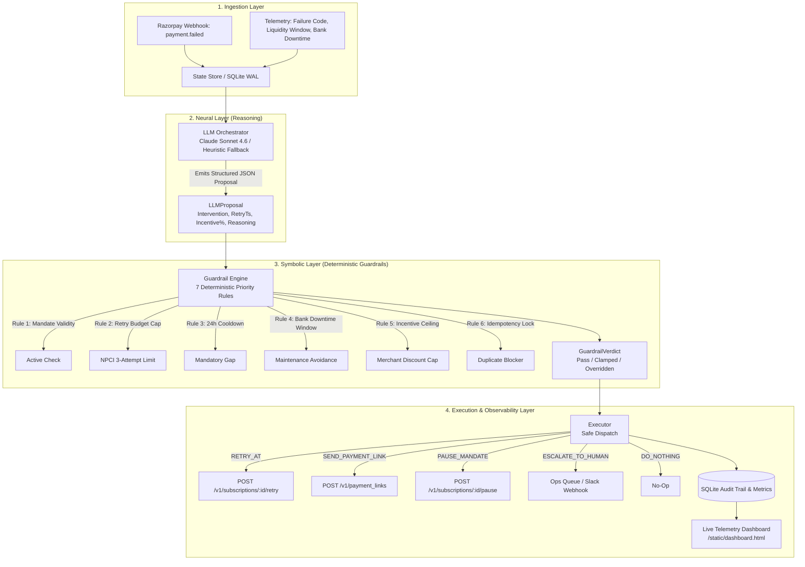

# TAHSĪL (تحصيل) — Autonomous AI Revenue Recovery Agent

> **Razorpay AI Buildathon — Track 03: AI Revenue Recovery**  
> *A Neuro-Symbolic Agentic Middleware for Autonomous Subscription Recovery across Indian Payment Rails (UPI AutoPay, eNACH, Cards).*

---

## 📌 Executive Summary

**Tahsīl (تحصيل)** is a backend AI revenue recovery system built for merchants operating recurring subscription businesses in India.

Instead of relying on naive fixed-interval retry schedules or handing unchecked execution authority to an LLM, Tahsīl implements a **Neuro-Symbolic Hybrid Architecture**:
1. **Neural Layer (LLM Proposer)**: Ingests rich payment failure telemetry (failure codes, customer lifetime value, historical liquidity windows, bank downtime forecasts) and uses Claude 3.5 Sonnet to reason through the optimal recovery strategy.
2. **Symbolic Layer (Deterministic Guardrail Engine)**: A pure-Python compliance firewall that enforces hard NPCI regulations, bank maintenance blackouts, mandatory cooldowns, and merchant incentive caps. **The LLM never executes directly — its proposal must pass the deterministic rules engine.**
3. **Execution Layer (Mocked Razorpay Dispatch)**: Safely formats and dispatches exact Razorpay API requests (`/v1/subscriptions/{id}/retry`, `/v1/payment_links`, `/v1/subscriptions/{id}/pause`) or routes to human ops queues with SQLite audit trails.

---

## 🏗️ Architecture: The Neuro-Symbolic Split



---

## 🇮🇳 Why Indian Payment Rails Require Deterministic Guardrails

Recurring payment recovery in India has strict regulatory and infrastructural constraints:

| Challenge | Real-World Impact | Tahsīl Deterministic Guardrail |
|---|---|---|
| **NPCI Retry Limits** | NPCI mandates a maximum of 3 presentation attempts per billing cycle on UPI AutoPay & eNACH. Repeated failures trigger bank penalties and user complaints. | **Rule 2**: If `retry_count >= 3`, any proposed retry is **strictly overridden** to `ESCALATE_TO_HUMAN`. |
| **24-Hour Cooldown** | Retrying automated debits without a 24-hour gap leads to immediate technical rejections. | **Rule 3**: Proposed timestamps earlier than `last_attempt + 24h` are automatically clamped forward. |
| **Bank Maintenance Blackouts** | Nocturnal batch maintenance (e.g. HDFC/SBI 02:00–06:00 AM) triggers spurious `INTERNAL_SYSTEM_ERROR` declines. | **Rule 4**: Retries colliding with downtime windows are automatically shifted past the window with a 15-min safety buffer. |
| **Revoked Mandates** | Customer revoking UPI AutoPay / eNACH mandate in their banking app makes debit attempts illegal. | **Rule 1**: Revoked or cancelled mandates force `DO_NOTHING`. |
| **Merchant Margin Protection** | An over-generous LLM might grant a 20% discount to secure payment on high-value churn risk. | **Rule 5**: Discounts are strictly capped to the merchant's `max_incentive_pct` (e.g., 5.0%). |
| **Duplicate Webhooks** | High-throughput webhook retries can cause race conditions and double billing. | **Rule 6**: Atomic database idempotency locks block duplicate processing. |

---

## ⚡ The Staged Failure Showcase (Judge Spotlight)

In **Scenario 3 (`scenario_exhausted_budget`)**:
* **Input State**: High-value enterprise subscription (₹4,999.00), already attempted 3 times (`retry_count: 3`), `max_retry_budget: 3`.
* **LLM Proposal**: The LLM observes the high customer lifetime value and generates a `RETRY_AT` proposal with reasoning: *"Customer has high historical lifetime value; attempting another automated debit retry after cooldown."*
* **Guardrail Interception**: The Guardrail Engine detects that retry budget is exhausted (`3 >= 3`).
* **Verdict**: **OVERRIDDEN** ➔ `ESCALATE_TO_HUMAN` (Override reason: *"NPCI retry budget exhausted (attempted 3 of max 3)"*).
* **Execution**: Dispatches an alert to the merchant operations team instead of triggering an illegal bank debit!

---

## 🔍 Real vs Mocked Boundaries

| Component | Status | Details |
|---|---|---|
| **LLM Reasoning Engine** | **REAL** | Structured tool calling using Anthropic Claude 3.5 Sonnet (`claude-sonnet-4-6`) with automated heuristic simulation fallback for offline resilience. |
| **Deterministic Guardrail Engine** | **REAL** | Pure-Python rule evaluation checking all 7 compliance policies. |
| **State Store & Event Audit** | **REAL** | Persistent SQLite database with WAL mode, state tracking, and idempotency locking. |
| **REST API Server** | **REAL** | FastAPI application exposing `/api/webhook/payment-failed`, `/api/metrics`, `/api/events`, `/api/states`, etc. |
| **Telemetry Dashboard** | **REAL** | Dark-mode live UI with auto-refreshing telemetry, scenario triggers, and audit logs. |
| **Razorpay API Dispatch** | **MOCKED** | Formats exact Razorpay API requests and logs simulated responses to avoid incurring live charges or needing production merchant credentials. |

---

## 🚀 Quickstart Guide

### 1. Prerequisites & Installation

```bash
# Clone and enter directory
cd TAHSIL

# Install dependencies
pip install -r requirements.txt
```

### 2. Configure Environment (Optional)

Create a `.env` file from `.env.example`:
```env
ANTHROPIC_API_KEY=your_anthropic_api_key_here
```
*(If no API key is provided, Tahsīl automatically utilizes its built-in rule-heuristic reasoning simulator with zero setup).*

### 3. Run Automated Unit Tests

Run the full pytest suite to verify all 7 guardrail rules and state store idempotency:
```bash
python -m pytest tests/ -v
```

### 4. Run the Narrated Terminal Demo

Experience the end-to-end recovery pipeline across all 6 production failure scenarios:
```bash
python scripts/demo_script.py
```

### 5. Launch the Web Server & Dashboard

Start the FastAPI server:
```bash
uvicorn app.main:app --reload
```
* **Interactive Dashboard**: Open [http://127.0.0.1:8000/dashboard](http://127.0.0.1:8000/dashboard)
* **Interactive API Documentation (Swagger)**: Open [http://127.0.0.1:8000/docs](http://127.0.0.1:8000/docs)

---

## 📡 REST API Reference

| Method | Endpoint | Description |
|---|---|---|
| `GET` | `/health` | Healthcheck and service metadata |
| `GET` | `/dashboard` | Redirects to modern live UI (`/static/dashboard.html`) |
| `POST` | `/api/webhook/payment-failed` | Ingests a recurring payment failure event and runs the neuro-symbolic pipeline |
| `GET` | `/api/metrics` | Returns live recovery statistics (overrides, total value at risk, override rate) |
| `GET` | `/api/events` | Lists chronological audit trail of all webhook, LLM, guardrail, and execution events |
| `GET` | `/api/states` | Returns latest recovery state for all ingested subscriptions |
| `GET` | `/api/scenarios` | Lists available demo test scenarios |
| `POST` | `/api/simulate/{scenario_name}` | Triggers recovery pipeline for a specific scenario |
| `POST` | `/api/simulate-all` | Batch-simulates all 6 test scenarios |
| `POST` | `/api/reset` | Clears all states, audit logs, and idempotency locks |

---

## 📁 Repository Structure

```
TAHSIL/
├── app/
│   ├── __init__.py
│   ├── schemas.py           # Pydantic models (RecoveryState, LLMProposal, GuardrailVerdict, RecoveryEvent)
│   ├── state_store.py       # SQLite persistence, WAL mode, event sourcing, idempotency
│   ├── guardrail_engine.py   # Pure-Python deterministic rules engine (7 priority rules)
│   ├── llm_orchestrator.py   # Claude Sonnet 4.6 tool-use reasoner with fallback
│   ├── executor.py          # Safe mocked Razorpay dispatch and ops alerting
│   ├── simulator.py         # 6 realistic recurring failure scenarios
│   └── main.py              # FastAPI server & REST endpoints
├── static/
│   └── dashboard.html       # Dark-mode dashboard with live telemetry & auto-refresh
├── scripts/
│   └── demo_script.py       # Interactive terminal demo walkthrough
├── tests/
│   └── test_guardrails.py   # 7 comprehensive pytest unit tests
├── requirements.txt         # Project dependencies
├── .env.example             # Template environment variables
└── README.md                # Project documentation
```

---

## 🏆 Hackathon Submission Details
* **Hackathon**: Razorpay AI Buildathon
* **Track**: Track 03 (AI Revenue Recovery)
* **Project Name**: TAHSĪL (تحصيل)
