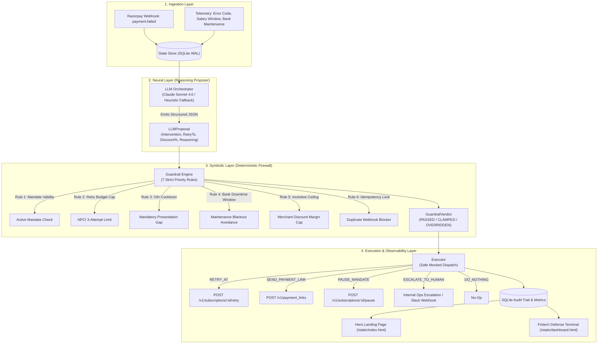

# TAHSĪL (تحصيل) — Autonomous Mandate Recovery Engine
### Razorpay AI Buildathon — Track 03: AI Revenue Recovery

<div align="center">

[](https://razorpay.com)
[](#-architecture-the-neuro-symbolic-split)
[](https://python.org)
[](https://fastapi.tiangolo.com)
[](https://anthropic.com)
[](LICENSE)

<br/>


<br/>

**“Brains to Reason. Brakes for Money.”**  
*An institutional-grade, neuro-symbolic recurring revenue recovery engine built for India’s payment infrastructure (UPI AutoPay, eNACH, and Cards).*

[🚀 Quickstart](#-quickstart-guide) • [🏛 Architecture](#-architecture-the-neuro-symbolic-split) • [🛡 Guardrail Rules](#-the-7-deterministic-guardrail-rules) • [⚡ Staged Failure Showcase](#-the-staged-failure-showcase-judge-spotlight) • [🖥 Defense Terminal](#-fintech-defense-terminal--ui-showcase) • [📡 REST API](#-rest-api-reference)

</div>

---

## 📌 Executive Summary

Recurring payment failures in India cost subscription merchants millions in unnecessary churn. Yet naive automated retries cause customer friction, bank penalty fees, and regulatory violations under NPCI and RBI rules.

**Tahsīl (تحصيل)** solves this with a **Neuro-Symbolic Hybrid Architecture**:
* **The Neural Layer (LLM Proposer)** uses Claude 3.5 Sonnet to ingest rich telemetry (failure codes, customer LTV, salary liquidity windows, bank downtime forecasts) and reason through the optimal recovery strategy.
* **The Symbolic Layer (Deterministic Guardrail Engine)** acts as an unbreachable Python firewall. **The LLM never executes directly.** Every proposal must pass 7 strict priority rules enforcing NPCI 3-attempt limits, 24-hour mandatory cooldowns, bank maintenance blackout shifts, and merchant discount caps.
* **The Execution Layer** safely logs and dispatches exact Razorpay REST payloads (`/v1/subscriptions/{id}/retry`, `/v1/payment_links`, `/v1/subscriptions/{id}/pause`) or alerts merchant operations queues.

```
┌────────────────────────────────────────────────────────────────────────────────────────┐
│                                 THE NON-NEGOTIABLE AXIOM                               │
│                                                                                        │
│   The LLM NEVER executes any recovery action directly.                                 │
│   It only emits structured JSON candidate proposals.                                   │
│   A separate, pure-Python deterministic guardrail engine evaluates, clamps, or         │
│   overrides that proposal against NPCI, RBI, and merchant rules before safe execution. │
└────────────────────────────────────────────────────────────────────────────────────────┘
```

---

## ⚖️ Why Traditional Recovery Fails vs. Tahsīl

| Dimension | Naive Fixed Cron Retries | Unchecked LLM Agent | Tahsīl (Neuro-Symbolic Engine) |
|---|---|---|---|
| **Liquidity Timing** | ❌ Blind retries at fixed 24h intervals | ⚠️ Hallucinates arbitrary dates | ✅ **Alters retries to match customer salary liquidity windows** |
| **Bank Maintenance** | ❌ Hits nocturnal batch downtime (02:00–06:00) | ❌ Ignores CBS maintenance calendars | ✅ **Shifts debit past downtime window with 15m safety buffer** |
| **Regulatory Limits** | ❌ Breaches NPCI 3-attempt cap | ❌ No compliance guarantees | ✅ **Strictly overrides to human ops when 3/3 attempts exhausted** |
| **Mandatory Cooldowns** | ❌ Triggers technical debit declines | ⚠️ May retry too quickly | ✅ **Clamps minimum 24-hour presentation spacing** |
| **Merchant Margins** | ❌ No dynamic payment links or incentives | ❌ May grant dangerous 20%+ discounts | ✅ **Clamps recovery discounts to merchant max cap (e.g., 5%)** |
| **Idempotency** | ⚠️ Race condition vulnerable | ❌ No state locks | ✅ **Atomic SQLite locks prevent duplicate billing** |

---

## 🏛 Architecture: The Neuro-Symbolic Split



---

## 🇮🇳 Indian Payment Rail Realities & Compliance

| Challenge | Real-World Impact | Tahsīl Deterministic Guardrail |
|---|---|---|
| **NPCI Retry Cap** | NPCI mandates max 3 presentation attempts per billing cycle on UPI AutoPay & eNACH. Further hits trigger bank fines & user complaints. | **Rule 2**: If `retry_count >= 3`, any proposed retry is **strictly overridden** to `ESCALATE_TO_HUMAN`. |
| **24-Hour Cooldown** | Retrying automated debits without a 24-hour gap leads to immediate technical rejections. | **Rule 3**: Proposed timestamps earlier than `last_attempt + 24h` are automatically clamped forward. |
| **Bank Maintenance Windows** | Nocturnal batch maintenance (e.g. HDFC/SBI 02:00–06:00 AM) triggers spurious `INTERNAL_SYSTEM_ERROR` declines. | **Rule 4**: Retries colliding with downtime windows are automatically shifted past the window with a 15-min safety buffer. |
| **Revoked Mandates** | Customer revoking UPI AutoPay / eNACH mandate in their banking app makes automated debit attempts illegal. | **Rule 1**: Revoked or cancelled mandates force `DO_NOTHING`. |
| **Merchant Margin Protection** | An over-generous LLM might grant a 15–20% discount to secure payment on high-value churn risk. | **Rule 5**: Discounts are strictly capped to the merchant's configured `max_incentive_pct` (e.g., 5.0%). |
| **Duplicate Webhooks** | High-throughput webhook retries cause race conditions and double-debiting. | **Rule 6**: Atomic database idempotency locks block duplicate processing. |

---

## ⚡ The Staged Failure Showcase (Judge Spotlight)

> **Scenario 3 (`scenario_exhausted_budget`) is our central demonstration feature.**  
> It highlights why autonomous agents in fintech must have deterministic guardrails.

```
┌────────────────────────────────────────────────────────────────────────────────────────┐
│                             SCENARIO 3: THE STAGED FAILURE                             │
│                                                                                        │
│  1. INGESTION : High-value enterprise account (₹4,999.00), already failed 3/3 times.   │
│  2. NEURAL    : Claude 3.5 Sonnet observes high LTV and attempts a 4th debit retry:    │
│                 "Customer has high historical lifetime value; attempting another        │
│                  automated debit retry after cooldown."                                │
│  3. SYMBOLIC  : Guardrail Rule 2 catches the violation (3/3 attempts exhausted).       │
│  4. VERDICT   : OVERRIDDEN ➔ ESCALATE_TO_HUMAN                                         │
│                 Override Reason: "NPCI retry budget exhausted (attempted 3 of max 3)" │
│  5. EXECUTION : Dispatches an urgent Ops alert instead of an illegal bank debit!      │
└────────────────────────────────────────────────────────────────────────────────────────┘
```

---

## 🛡 The 7 Deterministic Guardrail Rules

```
Rule 1: Mandate Validity Check
   └─ IF mandate_status != "active" ➔ OVERRIDE to DO_NOTHING

Rule 2: NPCI Retry Budget Cap (Max 3 Attempts)
   └─ IF proposal == RETRY_AT AND retry_count >= max_retry_budget ➔ OVERRIDE to ESCALATE_TO_HUMAN

Rule 3: Mandatory 24-Hour Cooldown
   └─ IF proposal.retry_ts < last_attempt_ts + 24h ➔ CLAMP retry_ts to (last_attempt_ts + 24h)

Rule 4: CBS Bank Downtime Window Avoidance
   └─ IF proposal.retry_ts collides with bank_downtime ➔ SHIFT retry_ts to (downtime_end + 15 min)

Rule 5: Merchant Incentive Ceiling
   └─ IF proposal.incentive_pct > max_incentive_pct ➔ CLAMP incentive_pct to max_incentive_pct (5%)

Rule 6: Atomic Idempotency Lock
   └─ IF is_locked(invoice_id, retry_count) == True ➔ OVERRIDE to DO_NOTHING

Rule 7: Policy Pass-Through
   └─ IF all compliance rules satisfied ➔ EMIT proposal as-is
```

---

## 🖥 Fintech Defense Terminal & UI Showcase

### 1. The Full-Viewport Dark Hero Page (`/static/index.html`)
* Cinematic CloudFront background video loop with dual-stacked scrim gradients.
* Custom typography: `Sora` (200/300/400) for architectural branding + `JetBrains Mono` for command tags.
* Instant simulation console to trigger test webhooks or jump directly into the live ops terminal.

### 2. The High-Density Defense Terminal (`/static/dashboard.html`)
* **Live KPI Counters**: Invoices Ingested, Recovery Decisions, Guardrail Overrides (with amber alert highlight), and Value at Risk Shielded.
* **Hardware Trigger Command Bus**: Uniform, tactile keys with accent dots (`24H Cooldown`, `Salary Liquidity`, `Staged Failure Override`, `Bank Downtime Shift`, `Mandate Revocation`, `Incentive Capping`).
* **Live Split Audit Ledger**:
  - **Left**: Real-time event log with color-coded status badges (`[ PASSTHROUGH ]` vs `[ OVERRIDDEN ⚠️ ]`).
  - **Right**: Deep Deconstruction Drawer displaying the exact **Neural Proposal vs. Symbolic Guardrail Diff** with custom JSON syntax highlighting.

---

## 🔍 Real vs. Mocked Boundaries (Transparency)

| Component | Status | Details |
|---|---|---|
| **LLM Reasoning Engine** | **REAL** | Structured tool calling using Anthropic Claude 3.5 Sonnet (`claude-sonnet-4-6`) with built-in heuristic fallback for zero-dependency offline resilience. |
| **Deterministic Guardrail Engine** | **REAL** | Pure-Python compliance firewall evaluating all 7 hard rules. |
| **State Store & Event Sourcing** | **REAL** | Persistent SQLite database with WAL mode, state tracking, and atomic idempotency locks. |
| **REST API Server** | **REAL** | FastAPI application exposing webhooks, metrics, states, and scenario triggers. |
| **Live Defense Terminal** | **REAL** | Real-time frontend with 2s polling, hardware trigger bus, and deep JSON inspector. |
| **Razorpay API Dispatch** | **MOCKED** | Formats exact Razorpay API requests and logs simulated responses to avoid incurring live charges or needing production merchant keys. |

---

## 🚀 Quickstart Guide

### 1. Prerequisites & Installation

```bash
# Clone repository
git clone https://github.com/Awwad-007/TAHSIL.git
cd TAHSIL

# Install dependencies
pip install -r requirements.txt
```

### 2. Configure Environment (Optional)

```bash
cp .env.example .env
```
*(Optional: Add your `ANTHROPIC_API_KEY`. If omitted, Tahsīl uses its built-in rule-heuristic reasoning simulator with zero setup).*

### 3. Run Automated Unit Tests

Verify all 7 guardrail rules and state store idempotency:
```bash
python -m pytest tests/ -v
```
```text
tests/test_guardrails.py::test_rule1_revoked_mandate_forces_do_nothing PASSED        [ 14%]
tests/test_guardrails.py::test_rule2_retry_budget_exhausted_overridden_to_escalate PASSED [ 28%]
tests/test_guardrails.py::test_rule3_cooldown_24h_clamped_forward PASSED            [ 42%]
tests/test_guardrails.py::test_rule4_bank_downtime_collision_shifted PASSED        [ 57%]
tests/test_guardrails.py::test_rule5_incentive_ceiling_clamped PASSED               [ 71%]
tests/test_guardrails.py::test_rule6_idempotency_lock_blocks_duplicate PASSED       [ 85%]
tests/test_guardrails.py::test_rule7_valid_proposal_passthrough PASSED              [100%]
============================== 7 passed in 0.26s ==============================
```

### 4. Run the Narrated Terminal Demo

```bash
python scripts/demo_script.py
```

### 5. Launch the Web Server & Dashboard

```bash
uvicorn app.main:app --reload
```
* **Landing Page**: [http://127.0.0.1:8000/](http://127.0.0.1:8000/)
* **Defense Terminal**: [http://127.0.0.1:8000/dashboard](http://127.0.0.1:8000/dashboard)
* **Interactive API Docs (Swagger)**: [http://127.0.0.1:8000/docs](http://127.0.0.1:8000/docs)

---

## 📡 REST API Reference

| Method | Endpoint | Description |
|---|---|---|
| `GET` | `/` | Serves the full-viewport Dark Hero Landing Page |
| `GET` | `/dashboard` | Serves the Fintech Defense Terminal |
| `GET` | `/health` | Healthcheck and service metadata |
| `POST` | `/api/webhook/payment-failed` | Ingests a recurring payment failure event and runs the neuro-symbolic pipeline |
| `GET` | `/api/metrics` | Returns live telemetry stats (overrides, total value at risk, override rate %) |
| `GET` | `/api/events` | Chronological audit trail of all webhook, LLM, guardrail, and execution events |
| `GET` | `/api/states` | Returns latest recovery state for all active subscriptions |
| `GET` | `/api/scenarios` | Lists available demo test scenarios |
| `POST` | `/api/simulate/{scenario_name}` | Triggers recovery pipeline for a specific scenario |
| `POST` | `/api/simulate-all` | Batch-simulates all 6 test scenarios in sequence |
| `POST` | `/api/reset` | Resets all database states, audit logs, and idempotency locks |

---

## 📁 Repository Structure

```
TAHSIL/
├── app/
│   ├── __init__.py
│   ├── schemas.py           # Pydantic V2 models (State, Proposal, Verdict, Events)
│   ├── state_store.py       # SQLite WAL persistence, idempotency locks & metrics
│   ├── guardrail_engine.py   # 7 deterministic priority compliance rules
│   ├── llm_orchestrator.py   # Claude Sonnet 4.6 tool-use reasoner with fallback
│   ├── executor.py          # Safe mocked Razorpay dispatch and ops alerting
│   ├── simulator.py         # 6 realistic recurring failure scenarios
│   └── main.py              # FastAPI server & REST endpoints
├── static/
│   ├── index.html           # Full-viewport dark hero landing page
│   └── dashboard.html       # High-density Fintech Defense Terminal
├── scripts/
│   └── demo_script.py       # Interactive terminal demo walkthrough
├── tests/
│   └── test_guardrails.py   # 7 comprehensive pytest unit tests
├── requirements.txt         # Project dependencies
├── .env.example             # Template environment variables
└── README.md                # Project documentation & pitch
```

---

## 🏆 Hackathon Submission Metadata

* **Hackathon**: Razorpay AI Buildathon
* **Track**: Track 03 (AI Revenue Recovery)
* **Project Name**: TAHSĪL (تحصيل)
* **Core Innovation**: Neuro-Symbolic Agentic Middleware (LLM Reasoning + Deterministic Pure-Python Guardrail Firewall for Indian Payment Rails).
